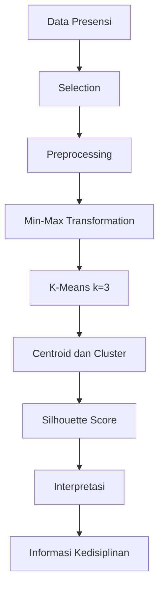

# High Level Design (HLD)

## 1. Arsitektur

```text
Browser
   |
   v
Frontend
   |
   v
REST API / Backend
   |
   +---- Attendance Service
   +---- KDD Preprocessing Service
   +---- K-Means Service
   +---- Evaluation Service
   +---- Interpretation Service
   |
   v
Database
```

## 2. Komponen
### Frontend
Menampilkan pemilihan periode, data presensi, proses K-Means, evaluasi, dan hasil kedisiplinan.

### Backend
Mengelola data presensi, proses KDD, clustering, evaluasi, dan API.

### K-Means Service
Melakukan inisialisasi centroid, perhitungan jarak, penentuan cluster, pembaruan centroid, dan iterasi sampai konvergen.

### Evaluation Service
Menghitung Silhouette Score.

### Database
Menyimpan periode, presensi, proses clustering, centroid, hasil cluster, dan evaluasi.

## 3. Alur Klasifikasi/Clustering


